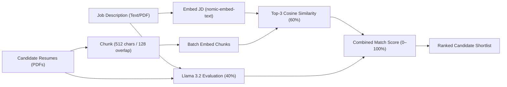

# Shortlyst

An autonomous, privacy-first talent screening platform that uses a **local RAG (Retrieval-Augmented Generation) pipeline** to screen, score, and rank candidates against job descriptions — completely offline with zero third-party API dependencies.

Built with Python (Flask) and powered by [Ollama](https://ollama.com) for on-device inference.

---

## Overview

Shortlyst replaces fragile keyword filters with a dual-signal evaluation engine that understands both semantic fit and qualitative career trajectory:

- **Semantic Vector Alignment (60% weight)**: Chunks resumes and generates dense embeddings with `nomic-embed-text`, evaluating cosine similarity against the job description vector.
- **LLM Reasoning & Assessment (40% weight)**: Leverages `llama3.2` to evaluate candidate credentials, identifying concrete strengths, critical gaps, and a definitive hire recommendation.
- **Image & PDF OCR**: Seamlessly accepts both standard PDF documents and image files (PNG, JPG, WEBP) for Job Descriptions and Resumes using on-device RapidOCR.
- **Dedicated Results Dashboard**: Redirects upon analysis to a standalone dashboard (`/results/<id>`) with SVG radial score rings, score breakdown bars, and CSV export.

> [!IMPORTANT]
> Shortlyst runs entirely on local models. Ensure [Ollama](https://ollama.com) is installed and active on your system before initiating candidate evaluations.

---

## Architecture

Shortlyst follows a modular Model-View-Controller (MVC) structure inside `shortlyst_app/`:

```
Shortlyst/
├── shortlyst_app/                  # Self-contained Flask application
│   ├── app.py                      # Application factory & runner
│   ├── requirements.txt            # Python dependencies
│   ├── .env                        # Local model & port configurations
│   ├── applications/               # Core services
│   │   ├── extensions.py           # SQLAlchemy & CORS setup
│   │   ├── pdf_service.py          # PyPDF stream extractor
│   │   ├── ollama_service.py       # REST client for embeddings & chat
│   │   └── rag_service.py          # Chunking, cosine similarity & scoring
│   ├── controllers/
│   │   └── controllers.py          # REST endpoints & view routing
│   ├── models/
│   │   └── models.py               # SQLite schema for jobs & candidates
│   ├── templates/                  # Server-rendered Jinja2 views
│   │   ├── base.html               # Global shell & live health indicator
│   │   └── index.html              # Interactive screening workspace
│   └── static/                     # Frontend assets (CSS & vanilla JS)
├── directives/                     # Standard Operating Procedures (SOPs)
└── execution/                      # Test suites & deterministic scripts
```

---

## Scoring Logic



### Recommendation Tiers

| Score Range | Classification | Recommendation |
| :--- | :--- | :--- |
| **80 – 100%** | `Strong Fit` | High priority for interview |
| **50 – 79%** | `Moderate Fit` | Qualified with addressable gaps |
| **0 – 49%** | `Not Fit` | Does not meet core requirements |

---

## Prerequisites

- **Python**: 3.10 or later
- **Ollama**: Installed and running locally ([Download Ollama](https://ollama.com))

Pull the required models:

```bash
ollama pull llama3.2
ollama pull nomic-embed-text
```

---

## Getting Started

### 1. Installation

Clone or extract the repository, then create and activate a virtual environment:

```bash
# Navigate to application
cd shortlyst_app

# Create virtual environment
python -m venv .venv

# Activate environment (Windows PowerShell)
.venv\Scripts\Activate.ps1

# Activate environment (Linux/macOS)
source .venv/bin/activate

# Install dependencies
pip install -r requirements.txt
```

### 2. Configuration

Create or update `.env` in `shortlyst_app/` if needed:

```env
PORT=5000
SECRET_KEY=your-secure-secret-key
DATABASE_URI=sqlite:///shortlyst.db
OLLAMA_BASE_URL=http://localhost:11434
OLLAMA_CHAT_MODEL=llama3.2
OLLAMA_EMBED_MODEL=nomic-embed-text
```

### 3. Running the Server

Start the application:

```bash
python app.py
```

The application will be accessible at `http://127.0.0.1:5000`.

> [!NOTE]
> The top navigation bar includes an automated Ollama connectivity indicator. A green pulse confirms models are reachable and ready to process requests.

---

## API Endpoints

| Method | Endpoint | Description |
| :--- | :--- | :--- |
| `GET` | `/` | Main interactive screening dashboard |
| `GET` | `/health` | API operational status |
| `GET` | `/api/health/llm` | Ollama connection and loaded model list |
| `POST` | `/api/upload-jd` | Parse Job Description from text or PDF |
| `POST` | `/api/upload-resumes` | Multi-file PDF resume text parser |
| `POST` | `/api/analyze` | Executes full RAG ranking pipeline |

---

## Testing

Run the automated test suite from the repository root:

```bash
python execution/test_shortlyst.py
```
